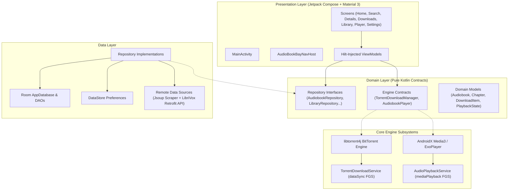
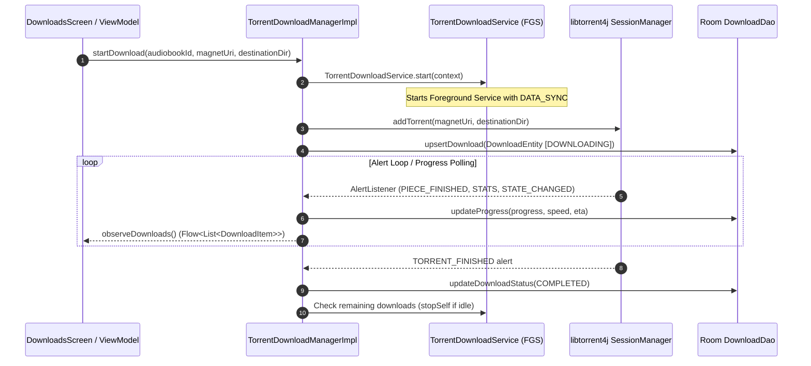
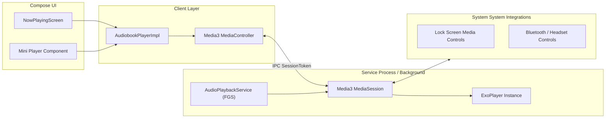
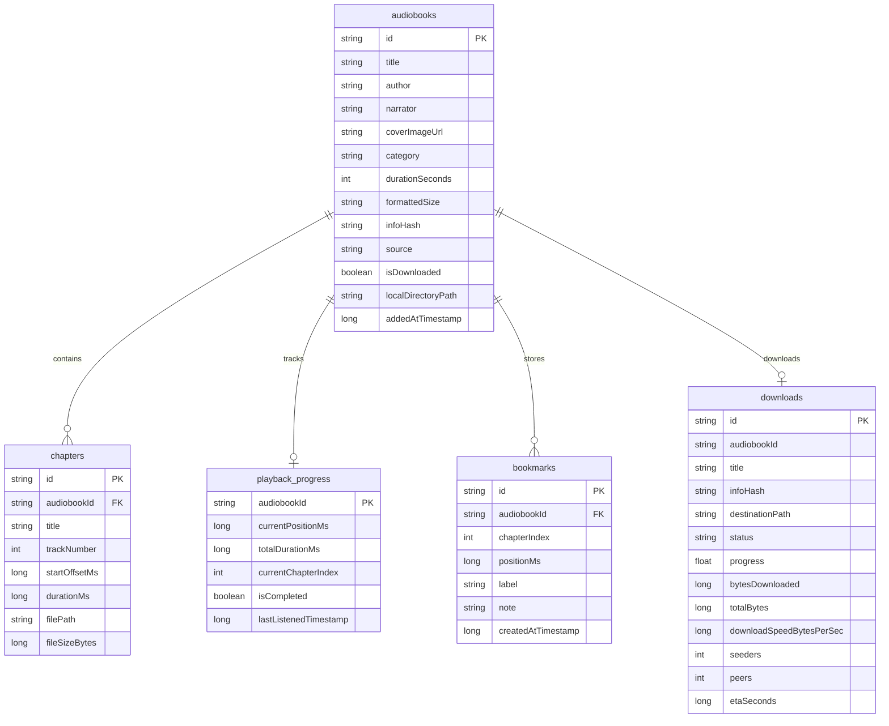

# Architecture Documentation — AudioBookBay Android

This document details the architectural foundation, layer contracts, data flow, component boundaries, and subsystem designs for the **AudioBookBay Android** application.

---

## 1. Architectural Philosophy

The application is engineered strictly following **Clean Architecture** principles and **Unidirectional Data Flow (UDF)**:

- **Presentation Layer (Compose + MVVM):** UI renders state and dispatches user actions upwards to ViewModels.
- **Domain Layer (Pure Business Logic):** Contains domain models, use cases, and repository interfaces. Independent of Android UI frameworks.
- **Data Layer (Persistence, Networking & Hardware):** Implements domain interfaces, coordinating between local Room persistence, remote HTTP/HTML endpoints, the BitTorrent engine, and Android system services.

---

## 2. Component Responsibilities & Boundaries

### 2.1 Domain Layer (`com.audiobookbay.app.domain`)

The domain layer establishes the contracts that shield the application against third-party API changes, library deprecations, and website structural changes.

| Component / Interface | File Location | Responsibility |
|---|---|---|
| `Audiobook` | [`model/Audiobook.kt`](file:///c:/Users/niko0/Documents/GitHub/AudioBookBayAndroid/app/src/main/java/com/audiobookbay/app/domain/model/Audiobook.kt) | Core lightweight audiobook summary model |
| `AudiobookDetail` | [`model/AudiobookDetail.kt`](file:///c:/Users/niko0/Documents/GitHub/AudioBookBayAndroid/app/src/main/java/com/audiobookbay/app/domain/model/AudiobookDetail.kt) | Full audiobook metadata, synopsis, and torrent info |
| `Chapter` | [`model/Chapter.kt`](file:///c:/Users/niko0/Documents/GitHub/AudioBookBayAndroid/app/src/main/java/com/audiobookbay/app/domain/model/Chapter.kt) | Individual audio track/chapter reference |
| `TorrentInfo` | [`model/TorrentInfo.kt`](file:///c:/Users/niko0/Documents/GitHub/AudioBookBayAndroid/app/src/main/java/com/audiobookbay/app/domain/model/TorrentInfo.kt) | Info hash, magnet URI, trackers, and file listing |
| `DownloadItem` | [`model/DownloadItem.kt`](file:///c:/Users/niko0/Documents/GitHub/AudioBookBayAndroid/app/src/main/java/com/audiobookbay/app/domain/model/DownloadItem.kt) | Active download state, speed, ETA, and progress |
| `PlaybackState` | [`model/PlaybackState.kt`](file:///c:/Users/niko0/Documents/GitHub/AudioBookBayAndroid/app/src/main/java/com/audiobookbay/app/domain/model/PlaybackState.kt) | Real-time media playback state (position, speed, pause) |
| `AudiobookRepository` | [`repository/AudiobookRepository.kt`](file:///c:/Users/niko0/Documents/GitHub/AudioBookBayAndroid/app/src/main/java/com/audiobookbay/app/domain/repository/AudiobookRepository.kt) | Browse, fetch details, categorize audiobooks |
| `AudiobookSearchRepository` | [`repository/AudiobookSearchRepository.kt`](file:///c:/Users/niko0/Documents/GitHub/AudioBookBayAndroid/app/src/main/java/com/audiobookbay/app/domain/repository/AudiobookSearchRepository.kt) | Search catalog and maintain search history |
| `TorrentDownloadManager` | [`repository/TorrentDownloadManager.kt`](file:///c:/Users/niko0/Documents/GitHub/AudioBookBayAndroid/app/src/main/java/com/audiobookbay/app/domain/repository/TorrentDownloadManager.kt) | Engine contract for torrent downloads |
| `AudiobookPlayer` | [`repository/AudiobookPlayer.kt`](file:///c:/Users/niko0/Documents/GitHub/AudioBookBayAndroid/app/src/main/java/com/audiobookbay/app/domain/repository/AudiobookPlayer.kt) | Engine contract for media playback |
| `LibraryRepository` | [`repository/LibraryRepository.kt`](file:///c:/Users/niko0/Documents/GitHub/AudioBookBayAndroid/app/src/main/java/com/audiobookbay/app/domain/repository/LibraryRepository.kt) | Local library management and disk scanning |
| `PlaybackProgressRepository` | [`repository/PlaybackProgressRepository.kt`](file:///c:/Users/niko0/Documents/GitHub/AudioBookBayAndroid/app/src/main/java/com/audiobookbay/app/domain/repository/PlaybackProgressRepository.kt) | Persistence of listening positions & bookmarks |

---

## 3. Subsystem Architectures

### 3.1 BitTorrent Engine Architecture

The BitTorrent subsystem is encapsulated behind `TorrentDownloadManager`. It uses `libtorrent4j` (FrostWire rasterbar JNI wrapper) targeting 64-bit and 32-bit Android architectures.

**Key Torrent Design Decisions:**
1. **Encapsulation:** Neither ViewModels nor UI code interact directly with `org.libtorrent4j.*`. All operations pass through `TorrentDownloadManager`.
2. **Foreground Service Lifecycle:** Long-running downloads require Android's `FOREGROUND_SERVICE_TYPE_DATA_SYNC`. Android 15 imposes a 6-hour cumulative background execution limit, so downloads must prioritize user-active sessions and save fast-resume data via `saveResumeData()`.
3. **Storage:** Torrent native code uses standard POSIX C++ file I/O. Therefore, files must be written to an app-specific directory (`context.getExternalFilesDir(Environment.DIRECTORY_DOWNLOADS)`) to avoid Scoped Storage SAF bottlenecks.

---

### 3.2 Audio Playback Subsystem (Media3 / ExoPlayer)

The playback system uses modern **AndroidX Media3**, superseding legacy ExoPlayer 2 and `MediaBrowserServiceCompat`.

**Audio Playback Highlights:**
- **Service:** `AudioPlaybackService` inherits from `MediaSessionService`. Android 14+ requires `FOREGROUND_SERVICE_TYPE_MEDIA_PLAYBACK`.
- **Audio Focus:** `ExoPlayer` is configured with `setAudioAttributes(C.AUDIO_CONTENT_TYPE_SPEECH, handleAudioFocus = true)`, ensuring automatic pause on incoming phone calls and polite ducking for notifications.
- **Progress Saving:** Playback positions are throttled and saved to Room via `PlaybackProgressRepository` every 10–15 seconds during active playback, and force-saved on pause or chapter transition.
- **Multi-File Audiobooks:** Audiobooks with multiple `.mp3` files are added as a playlist of `MediaItem`s. Media3 handles gapless playback natively.

---

### 3.3 Remote Data & Scraper Architecture

Because AudioBookBay.lu does not provide an official API and is protected by Cloudflare anti-bot mechanisms:

1. **`AudioBookBayParser`:** Jsoup-based HTML parser designed with defensive selectors and fallback regexes. Extracts:
   - Book title, author, narrator, category, cover URL.
   - Raw 40-character hex **Info Hash** from the detail page table.
   - Synthesizes a valid magnet link with standard public trackers:
     `magnet:?xt=urn:btih:<hash>&dn=<title>&tr=udp%3A%2F%2Ftracker.openbittorrent.com%3A80`
2. **`LibriVoxApi` (Fallback / Public Domain):**
   - Pure REST API (`https://librivox.org/api/feed/audiobooks/?format=json`).
   - Free, legal, unblocked catalog of 20,000+ public domain audiobooks.
   - Used as an immediate test bed and automatic fallback when AudioBookBay triggers a 403/Cloudflare challenge.

---

### 3.4 Local Persistence (Room Database)

Database: `audiobookbay.db` via `AppDatabase`

---

## 4. UI Navigation & Screen Hierarchy

Type-safe navigation routes are managed with `NavRoute` in `AudioBookBayNavHost`:

- `NavRoute.Home` — Discover audiobooks, featured recommendations, recently added.
- `NavRoute.Search` — Real-time search with debouncing and search history.
- `NavRoute.Categories` — Genre and category browsing.
- `NavRoute.AudiobookDetail(audiobookId)` — Detailed synopsis, torrent info, chapter breakdown, download trigger.
- `NavRoute.Downloads` — Real-time torrent download queue, speed, pause/resume/cancel controls.
- `NavRoute.Library` — Local library of completed audiobooks, progress badges, offline playback.
- `NavRoute.NowPlaying` — Full-screen audio player with scrub bar, speed modifier, sleep timer, and chapter drawer.
- `NavRoute.Settings` — Theme, Wi-Fi constraints, storage directory, and content sources.

## Implementation update — 2026-11-01

Discovery uses a Hilt HomeViewModel, read-only StateFlow<UiState<HomeContent>>,
and lifecycle-aware Compose collection. HomeContent retains loaded cards during
refresh and pagination. Refresh cancels prior work; pages deduplicate book IDs,
and errors retry the failed page without advancing the page counter.

Search uses a 300 ms cancellable delay and cancels stale queries immediately.
History is an ordered list capped at 20 entries in DataStore, migrated from the
original string set. DetailViewModel decodes the type-safe SavedStateHandle route.

LibriVox IDs are namespaced as librivox:<id>. Requests use documented coverart and
id parameters. url_other uses JsonElement because its shape varies. Ascending
ordering is deliberate: descending IDs included unfinished recordings in a live
API check. Pagination stays on one source until refresh. ABB search returned home
listings in verification, so unrelated results are rejected before fallback.
Responses are closed, cancellation propagates, and transport errors can trigger
LibriVox fallback. The dispatcher now has the required @IoDispatcher qualifier.

Room version 2 adds catalog_cache for listing snapshots and full details, separate
from owned library metadata and local file paths. Migration 1 to 2 creates only
this table; destructive migration was removed. Refresh invalidates older pages.
An offline catalog stays on cached pages until refresh to prevent source mixing.
Cache write failure cannot hide a successful network response.

The verified ABB detail path is /abss/<slug>/, replacing the scaffold's incorrect
/audio/<slug>/. The parser rejects challenge pages as details and separates
inline author, narrator, format and bitrate labels. No access control is bypassed.

### Native torrent implementation

TorrentDownloadManagerImpl now owns an IO-dispatched SessionManager behind the
existing domain contract. Room downloads are the observable queue. Atomic internal
JSON request files and native resume blobs survive manager/session recreation.
Interrupted requests restore paused and need a user resume, so process startup does
not attempt an unlawful background foreground-service launch. Queue observation
normalizes interrupted in-memory states without starting a native session.

Only v1/hybrid hashes and the configured arm64 native binary are currently supported.
API 26/27 can browse but the engine explicitly requires API 28. All destination and
metadata file paths must stay within app-specific downloads. Default selection skips
non-audio files. Metadata acquisition uses UPLOAD_MODE, then enables piece requests
after paths and priorities are validated. Initial zero priorities caused local seeds
to disconnect, which the native transfer test exposed.

Native add/resume alerts handle asynchronous errors and checkpoint data. Native status
is polled every 2 seconds; periodic resume checkpoints run every 30 seconds, plus pause,
completion and shutdown saves. Completed torrents pause rather than seed indefinitely.
The foreground service observes persisted progress, stops when idle, and handles API35
onTimeout. Idle cleanup checks under the engine lock so it cannot stop a newly queued
transfer. Android15 timeout behavior still needs an actual API35 device test.

Downloads UI accepts a manual magnet or SAF torrent document and delegates to the domain
manager. Imports copy at most 10 MiB into temporary cache before the engine stores its
private copy. Notification permission is requested on user download/import actions.
Queue removal preserves files. Automatic transfer into the library is the next milestone.

## Product revision: downloader only (2026-11-01)

This section supersedes the earlier proposed player/library subsystems. The user
uses a separate player. Media3, AudioPlaybackService and player/library navigation
have been removed; the only long-running service is the dataSync download service.
Legacy playback/bookmark/chapter tables remain as inert compatibility data.

DownloadMetadata now requires author, book title and a destination tree URI. The
native engine owns app-specific staging paths rather than exposing them as the
user's final destination. A completed native payload persists a PublicationFile
manifest and enters PUBLISHING. BookPublisher streams to Android DocumentsContract
URIs via SafPublicationStorage, verifies SHA-256, journals completed copies, then
renames its hidden staging book directory into Author/Book Title. Collisions get
numbered book folders and never replace existing books. Torrent wrappers are removed
without flattening disc folders. Invalid path segments cannot escape the chosen tree.

DownloadFolderSettings persists the ACTION_OPEN_DOCUMENT_TREE read/write grant and
validates create/write/rename support. The suggested initial location is Android;
the user creates/selects AudioBooks underneath it. The connected Android14 phone
confirmed this exact location is permitted. If an OEM denies it, the UI requires an
explicit alternative location. No all-files permission or raw shared POSIX path is used.

Room version3 adds author, destinationTreeUri, publishedFolderUri and
publicationProgress to downloads. Migration2to3 is additive; legacy tables are kept.
COMPLETED means shared verification succeeded, not simply native transfer completion.
PUBLICATION_FAILED retains verified staging for retry without torrent downloads.
Native resume state and publication journals have separate lifetimes. Copying remains
inside the foreground service's active-work budget; shutdown interrupts it safely.

The publisher's durable file checkpoints support process-independent recreation.
A per-book marker recovers rename-before-commit interruptions. Low-storage write
failures retain runtime error state and source audio. Successful publication removes
owned temporary audio; removing a history entry never deletes the shared audiobook.
