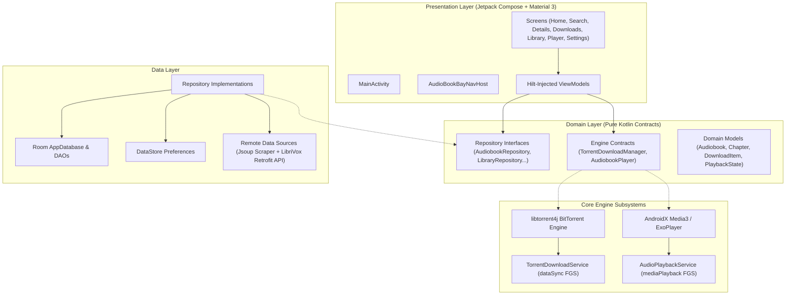
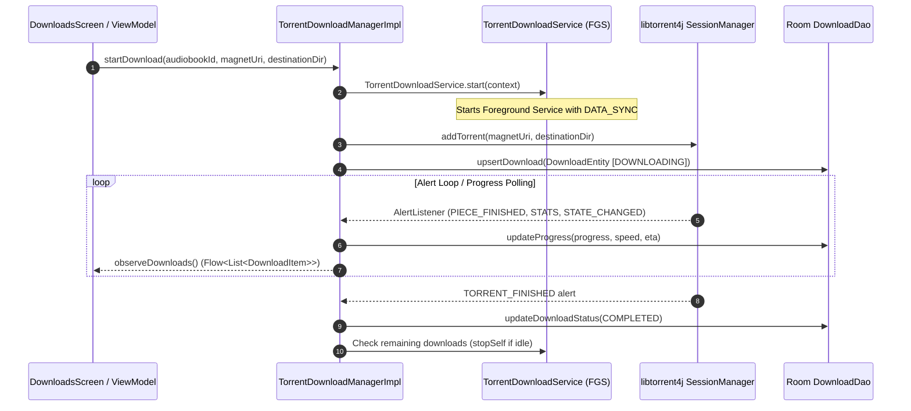
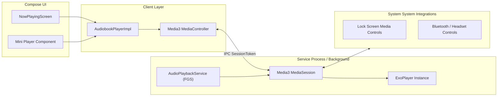
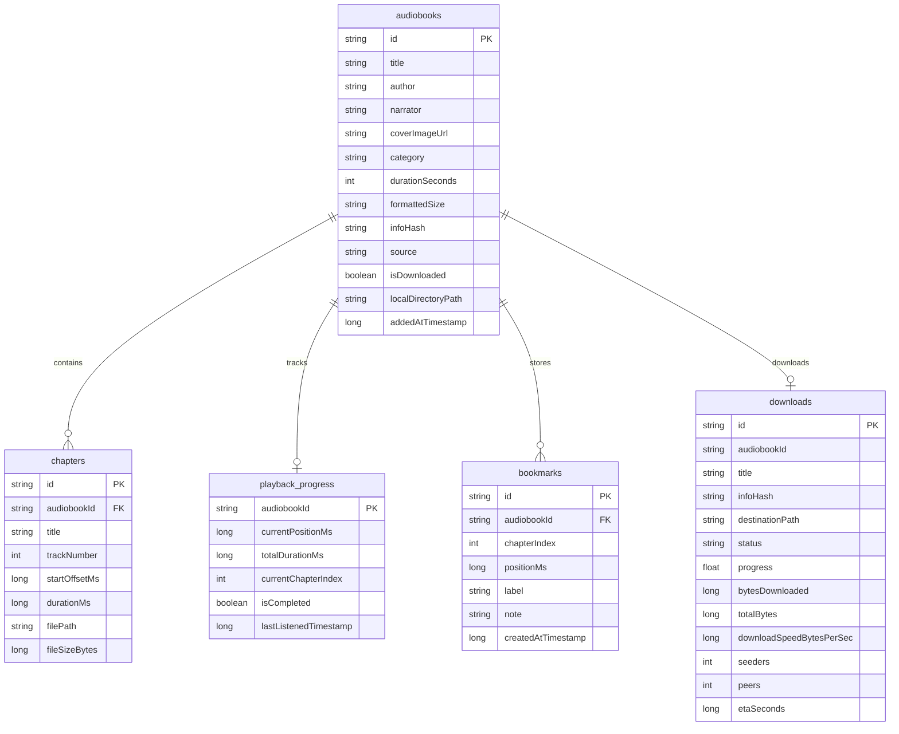

# Architecture Documentation — AudioBookBay Android

This document details the architectural foundation, layer contracts, data flow, component boundaries, and subsystem designs for the **AudioBookBay Android** application.

---

## 1. Architectural Philosophy

The application is engineered strictly following **Clean Architecture** principles and **Unidirectional Data Flow (UDF)**:

- **Presentation Layer (Compose + MVVM):** UI renders state and dispatches user actions upwards to ViewModels.
- **Domain Layer (Pure Business Logic):** Contains domain models, use cases, and repository interfaces. Independent of Android UI frameworks.
- **Data Layer (Persistence, Networking & Hardware):** Implements domain interfaces, coordinating between local Room persistence, remote HTTP/HTML endpoints, the BitTorrent engine, and Android system services.

---

## 2. Component Responsibilities & Boundaries

### 2.1 Domain Layer (`com.audiobookbay.app.domain`)

The domain layer establishes the contracts that shield the application against third-party API changes, library deprecations, and website structural changes.

| Component / Interface | File Location | Responsibility |
|---|---|---|
| `Audiobook` | [`model/Audiobook.kt`](file:///c:/Users/niko0/Documents/GitHub/AudioBookBayAndroid/app/src/main/java/com/audiobookbay/app/domain/model/Audiobook.kt) | Core lightweight audiobook summary model |
| `AudiobookDetail` | [`model/AudiobookDetail.kt`](file:///c:/Users/niko0/Documents/GitHub/AudioBookBayAndroid/app/src/main/java/com/audiobookbay/app/domain/model/AudiobookDetail.kt) | Full audiobook metadata, synopsis, and torrent info |
| `Chapter` | [`model/Chapter.kt`](file:///c:/Users/niko0/Documents/GitHub/AudioBookBayAndroid/app/src/main/java/com/audiobookbay/app/domain/model/Chapter.kt) | Individual audio track/chapter reference |
| `TorrentInfo` | [`model/TorrentInfo.kt`](file:///c:/Users/niko0/Documents/GitHub/AudioBookBayAndroid/app/src/main/java/com/audiobookbay/app/domain/model/TorrentInfo.kt) | Info hash, magnet URI, trackers, and file listing |
| `DownloadItem` | [`model/DownloadItem.kt`](file:///c:/Users/niko0/Documents/GitHub/AudioBookBayAndroid/app/src/main/java/com/audiobookbay/app/domain/model/DownloadItem.kt) | Active download state, speed, ETA, and progress |
| `PlaybackState` | [`model/PlaybackState.kt`](file:///c:/Users/niko0/Documents/GitHub/AudioBookBayAndroid/app/src/main/java/com/audiobookbay/app/domain/model/PlaybackState.kt) | Real-time media playback state (position, speed, pause) |
| `AudiobookRepository` | [`repository/AudiobookRepository.kt`](file:///c:/Users/niko0/Documents/GitHub/AudioBookBayAndroid/app/src/main/java/com/audiobookbay/app/domain/repository/AudiobookRepository.kt) | Browse, fetch details, categorize audiobooks |
| `AudiobookSearchRepository` | [`repository/AudiobookSearchRepository.kt`](file:///c:/Users/niko0/Documents/GitHub/AudioBookBayAndroid/app/src/main/java/com/audiobookbay/app/domain/repository/AudiobookSearchRepository.kt) | Search catalog and maintain search history |
| `TorrentDownloadManager` | [`repository/TorrentDownloadManager.kt`](file:///c:/Users/niko0/Documents/GitHub/AudioBookBayAndroid/app/src/main/java/com/audiobookbay/app/domain/repository/TorrentDownloadManager.kt) | Engine contract for torrent downloads |
| `AudiobookPlayer` | [`repository/AudiobookPlayer.kt`](file:///c:/Users/niko0/Documents/GitHub/AudioBookBayAndroid/app/src/main/java/com/audiobookbay/app/domain/repository/AudiobookPlayer.kt) | Engine contract for media playback |
| `LibraryRepository` | [`repository/LibraryRepository.kt`](file:///c:/Users/niko0/Documents/GitHub/AudioBookBayAndroid/app/src/main/java/com/audiobookbay/app/domain/repository/LibraryRepository.kt) | Local library management and disk scanning |
| `PlaybackProgressRepository` | [`repository/PlaybackProgressRepository.kt`](file:///c:/Users/niko0/Documents/GitHub/AudioBookBayAndroid/app/src/main/java/com/audiobookbay/app/domain/repository/PlaybackProgressRepository.kt) | Persistence of listening positions & bookmarks |

---

## 3. Subsystem Architectures

### 3.1 BitTorrent Engine Architecture

The BitTorrent subsystem is encapsulated behind `TorrentDownloadManager`. It uses `libtorrent4j` (FrostWire rasterbar JNI wrapper) targeting 64-bit and 32-bit Android architectures.

**Key Torrent Design Decisions:**
1. **Encapsulation:** Neither ViewModels nor UI code interact directly with `org.libtorrent4j.*`. All operations pass through `TorrentDownloadManager`.
2. **Foreground Service Lifecycle:** Long-running downloads require Android's `FOREGROUND_SERVICE_TYPE_DATA_SYNC`. Android 15 imposes a 6-hour cumulative background execution limit, so downloads must prioritize user-active sessions and save fast-resume data via `saveResumeData()`.
3. **Storage:** Torrent native code uses standard POSIX C++ file I/O. Therefore, files must be written to an app-specific directory (`context.getExternalFilesDir(Environment.DIRECTORY_DOWNLOADS)`) to avoid Scoped Storage SAF bottlenecks.

---

### 3.2 Audio Playback Subsystem (Media3 / ExoPlayer)

The playback system uses modern **AndroidX Media3**, superseding legacy ExoPlayer 2 and `MediaBrowserServiceCompat`.

**Audio Playback Highlights:**
- **Service:** `AudioPlaybackService` inherits from `MediaSessionService`. Android 14+ requires `FOREGROUND_SERVICE_TYPE_MEDIA_PLAYBACK`.
- **Audio Focus:** `ExoPlayer` is configured with `setAudioAttributes(C.AUDIO_CONTENT_TYPE_SPEECH, handleAudioFocus = true)`, ensuring automatic pause on incoming phone calls and polite ducking for notifications.
- **Progress Saving:** Playback positions are throttled and saved to Room via `PlaybackProgressRepository` every 10–15 seconds during active playback, and force-saved on pause or chapter transition.
- **Multi-File Audiobooks:** Audiobooks with multiple `.mp3` files are added as a playlist of `MediaItem`s. Media3 handles gapless playback natively.

---

### 3.3 Remote Data & Scraper Architecture

Because AudioBookBay.lu does not provide an official API and is protected by Cloudflare anti-bot mechanisms:

1. **`AudioBookBayParser`:** Jsoup-based HTML parser designed with defensive selectors and fallback regexes. Extracts:
   - Book title, author, narrator, category, cover URL.
   - Raw 40-character hex **Info Hash** from the detail page table.
   - Synthesizes a valid magnet link with standard public trackers:
     `magnet:?xt=urn:btih:<hash>&dn=<title>&tr=udp%3A%2F%2Ftracker.openbittorrent.com%3A80`
2. **`LibriVoxApi` (Fallback / Public Domain):**
   - Pure REST API (`https://librivox.org/api/feed/audiobooks/?format=json`).
   - Free, legal, unblocked catalog of 20,000+ public domain audiobooks.
   - Used as an immediate test bed and automatic fallback when AudioBookBay triggers a 403/Cloudflare challenge.

---

### 3.4 Local Persistence (Room Database)

Database: `audiobookbay.db` via `AppDatabase`

---

## 4. UI Navigation & Screen Hierarchy

Type-safe navigation routes are managed with `NavRoute` in `AudioBookBayNavHost`:

- `NavRoute.Home` — Discover audiobooks, featured recommendations, recently added.
- `NavRoute.Search` — Real-time search with debouncing and search history.
- `NavRoute.Categories` — Genre and category browsing.
- `NavRoute.AudiobookDetail(audiobookId)` — Detailed synopsis, torrent info, chapter breakdown, download trigger.
- `NavRoute.Downloads` — Real-time torrent download queue, speed, pause/resume/cancel controls.
- `NavRoute.Library` — Local library of completed audiobooks, progress badges, offline playback.
- `NavRoute.NowPlaying` — Full-screen audio player with scrub bar, speed modifier, sleep timer, and chapter drawer.
- `NavRoute.Settings` — Theme, Wi-Fi constraints, storage directory, and content sources.
